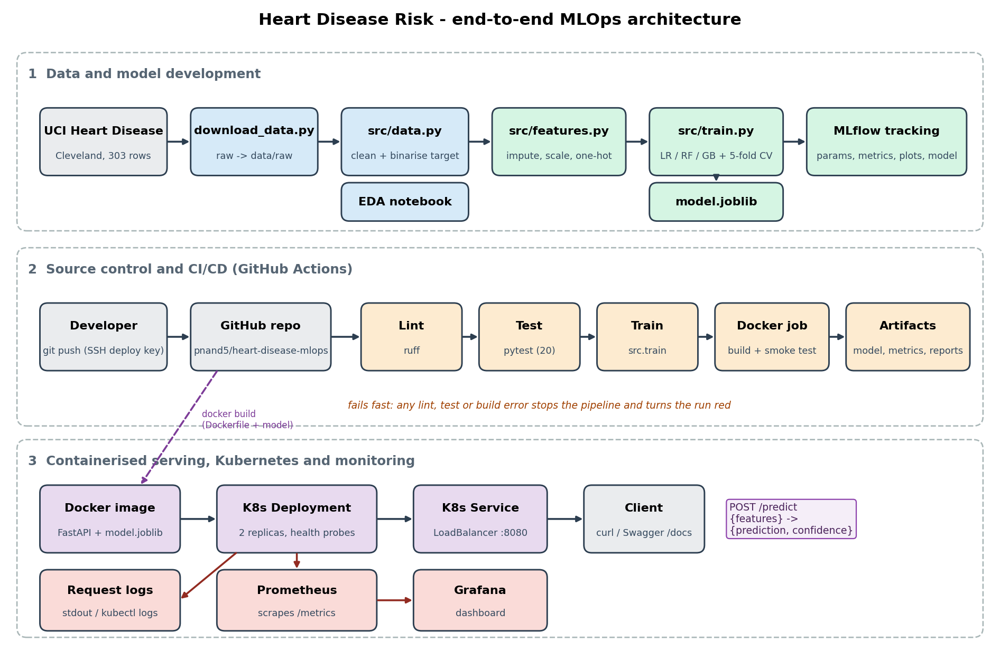

# Heart Disease Risk - End-to-End MLOps Pipeline

BITS Pilani MTech (AIML), MLOps (AIMLCZG523), Assignment 1.

A reproducible pipeline that predicts the presence of heart disease from patient health data (UCI Heart
Disease, Cleveland subset): data acquisition and EDA, model training with experiment tracking, packaging,
automated testing and CI, a containerised FastAPI service, a Kubernetes deployment and basic monitoring.



## Results at a glance

| Model | CV ROC-AUC (5-fold, train split) | Test ROC-AUC | Test accuracy | Test recall |
|---|---|---|---|---|
| **Logistic Regression (selected)** | **0.902** | 0.966 | 0.885 | 0.929 |
| Random Forest | 0.901 | 0.944 | 0.836 | 0.821 |
| Gradient Boosting | 0.875 | 0.951 | 0.885 | 0.929 |

Logistic Regression and Random Forest are tied on cross-validation, and the test split is only 61 patients,
so the choice is justified by simplicity and interpretability, not by a significant accuracy gap. Details in the
[report](report/) and `notebooks/02_training.ipynb`.

## Repository layout

```
data/raw, data/processed   downloaded UCI file and the cleaned CSV
scripts/                   download_data.py, generate_traffic.py
src/                       data.py (cleaning), features.py (preprocessing), train.py, predict.py
notebooks/                 01_eda, 02_training, 03_inference (executed, outputs included)
api/                       FastAPI app (/predict, /health, /metrics) and request/response schemas
tests/                     pytest suite (data, features, model, API)
k8s/                       namespace, deployment, service manifests
monitoring/                Prometheus config and provisioned Grafana dashboard
.github/workflows/ci.yml   lint -> test -> train -> docker build + smoke test
Dockerfile, docker-compose.yml, Makefile, requirements*.txt
models/model.joblib        final pipeline (preprocessing + classifier)
report/, screenshots/, evidence/   report, screenshots and captured command output
```

## Quick start (clean machine)

Requires Python 3.10, and Docker for the container/monitoring steps.

```bash
git clone https://github.com/pnand5/heart-disease-mlops.git && cd heart-disease-mlops
python3 -m venv .venv && source .venv/bin/activate
pip install -r requirements.txt

python scripts/download_data.py     # fetch the UCI data into data/raw/
python -m src.data                  # clean it into data/processed/heart_clean.csv
python -m src.train                 # tune + evaluate 3 models, log to MLflow, save models/model.joblib
pytest -v                           # 20 tests
ruff check .                        # lint
```

`make setup | data | train | test | lint | run | docker-build | docker-run | monitoring-up | mlflow-ui`
wrap the same commands.

### Experiment tracking (MLflow)

```bash
make mlflow-ui          # http://localhost:5001  (5000 is reserved by AirPlay on macOS)
```

Each model is one run in the `heart-disease-classification` experiment. Logged per run: tuned parameters, the search
grid, 5-fold CV metrics (mean and std), held-out test metrics, confusion-matrix and ROC plots, and the fitted pipeline
(MLflow model). The selected run is tagged `selected=true`.

### Serving locally

```bash
uvicorn api.app:app --port 8000            # or: make docker-build && make docker-run
curl -X POST http://localhost:8000/predict -H 'Content-Type: application/json' -d '{
  "age":63,"sex":1,"cp":1,"trestbps":145,"chol":233,"fbs":1,"restecg":2,
  "thalach":150,"exang":0,"oldpeak":2.3,"slope":3,"ca":0,"thal":6}'
# {"prediction":0,"diagnosis":"no heart disease","confidence":0.8345,"probability_disease":0.1655}
```

`confidence` is the probability of the predicted class; `probability_disease` is always P(disease). Invalid input
(out-of-range or missing fields) returns HTTP 422. Interactive docs are at `/docs`.

### Kubernetes (Docker Desktop)

```bash
docker build -t heart-disease-api:latest .
kubectl --context docker-desktop apply -f k8s/
kubectl --context docker-desktop -n heart-disease get pods,svc
curl http://localhost:8080/health          # LoadBalancer service -> localhost:8080
```

Two replicas with readiness/liveness probes behind a `LoadBalancer` service. The image uses
`imagePullPolicy: Never`, so it must be built locally first (no registry is involved). Pass `--context` explicitly if
you have other clusters in your kubeconfig.

### Monitoring (Prometheus + Grafana)

```bash
make monitoring-up                                  # api :8000, Prometheus :9090, Grafana :3000
python scripts/generate_traffic.py --seconds 120    # mixed valid/invalid requests
```

Open <http://localhost:3000/d/heart-api/heart-disease-api> (anonymous viewing is enabled; admin login `admin`/`admin`
is a local-only default). The API logs every request and prediction to stdout and exposes request counts,
latency histograms and prediction counts at `/metrics`.

## Report

`report/build_report.py` regenerates `report/Heart_Disease_MLOps_Report.pdf` (Chrome headless) and the editable `.docx`
from one content definition, embedding every image in `screenshots/` and `report/figures/`:

```bash
.venv/bin/python report/build_report.py     # missing screenshots become marked placeholders
```

## CI/CD

`.github/workflows/ci.yml` runs on every push (and manually):

1. **build-test-train**: install pinned dependencies, `ruff` lint, download data, `pytest`, train the models
   (MLflow), upload the test report and the model/metrics/MLflow runs as workflow artifacts.
2. **docker**: build the image, start the container and call `/health` and `/predict`.

Any failing step stops the pipeline and marks the run red; logs are kept per step.

## Design notes and limitations

- **One artifact for train and serve.** The saved model is the entire scikit-learn `Pipeline`
  (imputation, scaling, one-hot encoding, classifier), so inference needs no separate preprocessing code and cannot drift
  from training. Unseen categories and missing values are handled instead of crashing.
- **No test-set leakage.** Tuning and model selection use only the training split; the test split is used once.
- **Small data.** 303 patients means wide uncertainty; metrics should be read with the CV standard deviations.
- **Not a medical device.** This is a coursework model trained on a historical research dataset.
- **Local deployment.** The "production" target is Docker Desktop Kubernetes, not a public cloud, so there is no public
  URL; access is via `localhost:8080` as above. The model file is committed so images build reproducibly; a real
  system would pull it from a model registry.
- **Not covered:** authentication, TLS, autoscaling, drift monitoring and automated retraining/deployment.

## Data

UCI Machine Learning Repository, Heart Disease (Cleveland): <https://archive.ics.uci.edu/dataset/45/heart+disease>.
`scripts/download_data.py` downloads the raw file; the cleaned CSV is committed at `data/processed/heart_clean.csv`.
